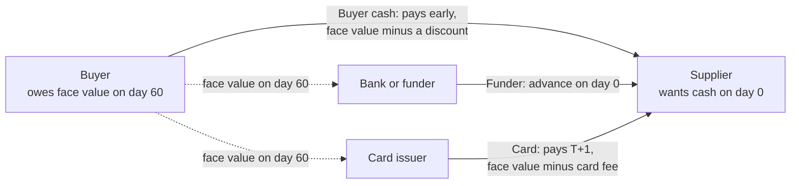
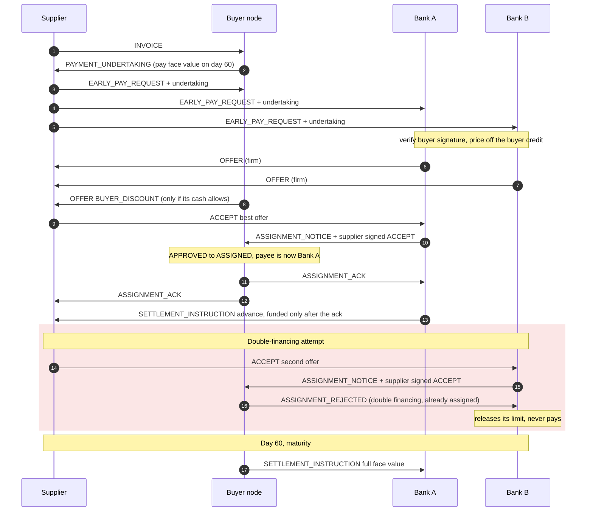
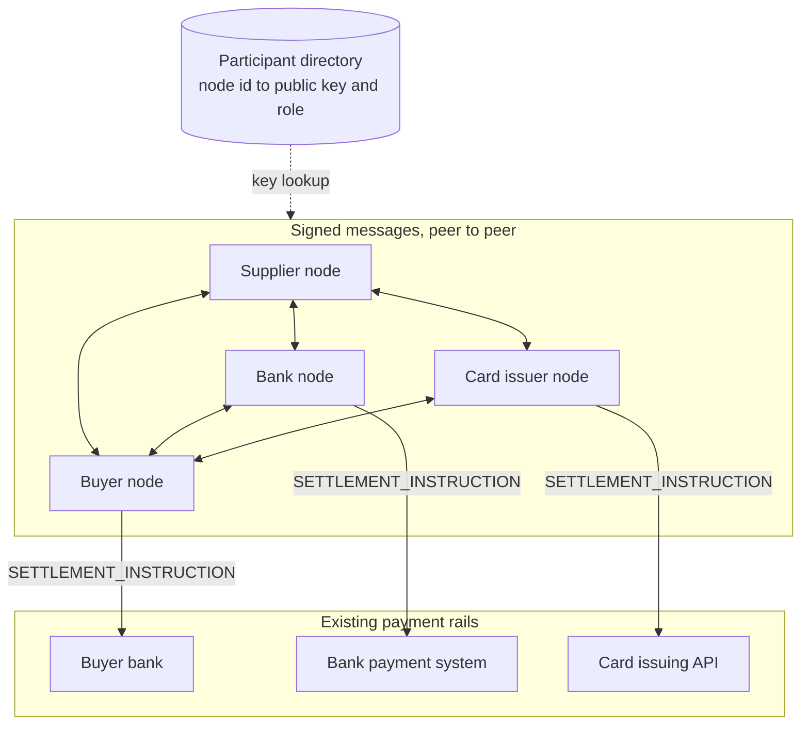

# OpenFloat

**An open protocol for financing at the payment layer.**

A supplier holding an invoice its buyer has approved should be able to get paid today, at a price based on
the *buyer's* credit, from whoever offers the cheapest money: the buyer's own cash, a bank, or a card
issuer. OpenFloat is the open, operator-less protocol that makes this possible, plus an Apache-2.0
reference implementation.

> Status: `openfloat/0.1` draft. Reference implementation and simulation only. No real money moves,
> and nodes only ever emit settlement *instructions* for existing payment rails.

## The problem

- Small suppliers who need cash before their invoices are due use **factoring**, which typically costs
  **~1–5% per month, around 30–57% APR**. That price reflects the supplier's credit.
- The same invoice, once a large buyer has confirmed it will pay, is close to a **buyer-quality asset**.
  Banks fund confirmed payables at roughly **benchmark + 60–100 bps**.
- That gap is today captured through **proprietary supply-chain-finance platforms**, each a closed
  silo run by one operator. Factoring volume alone is over **€4tn a year**, and supply chain finance is
  around **$2.6tn**.
- Silos are opaque. **Double financing**, the same receivable funded more than once, is a recurring
  failure mode in the sector. It is under investigation in the 2025 First Brands bankruptcy, and
  opacity was central to the 2021 Greensill collapse.

Sources and confidence levels: [docs/market-context.md](docs/market-context.md).

## How it works

**The gap.** The supplier wants cash on day 0. The buyer has approved the invoice and will pay it on
day 60. Any of three liquidity sources can fill the gap, and the supplier takes the cheapest offer.



**The messages.** Happy path with two competing banks, followed by a supplier trying to finance the
same invoice a second time.



**The network.** Every participant runs its own node. Nodes exchange signed messages directly, resolve
each other's keys through a participant directory, and emit settlement instructions to the payment
rails each participant already uses. There is no central platform in the message path.



- **No central operator.** The buyer, who owes the money, is the natural source of truth for who gets
  paid. Its node acknowledges one assignment per invoice and rejects any second claim, the same logic as
  a notice of assignment in receivables law.
- **Everything is signed** (Ed25519 over canonical JSON). Claims carry the counterparty's signed message
  as proof, so any node can verify without trusting anyone in the middle.
- **Deterministic decisions.** Pricing, limits and the buyer's cash allocation are deterministic. The
  buyer decides which early payments to fund itself with a MILP that respects a daily cash floor and a
  payables forecast.

Full protocol: **[SPEC.md](SPEC.md)**.

## Quickstart

Requires Python 3.12+ and [uv](https://docs.astral.sh/uv/).

```bash
git clone https://github.com/4rnaudD/openfloat && cd openfloat
uv sync
uv run openfloat simulate            # synthetic network: 1 buyer, 25 suppliers, 2 banks, 1 card issuer
uv run openfloat simulate --no-forecast   # see what happens when the buyer ignores its forecast
uv run openfloat dashboard           # interactive walkthrough, network outcome and message log
uv run pytest                        # protocol and invariant tests
```

## Results on synthetic data

Synthetic scenario: about 185 invoices over 30 days, 60% of suppliers wanting early payment, supplier
factoring rates drawn from 20–45% APR, banks at 5.5% and 6.2%, card at a 2% flat fee, 5% of suppliers
attempting to double-finance. Three seeds.

| Metric | Result |
|---|---|
| Early-payment requests financed | 107–110 of 107–110 (100%) |
| Route mix | ~50% buyer cash, ~50% banks |
| **Supplier financing cost vs. own factoring** | **~$19.6k vs ~$116k on ~$2.46M financed** (seed 7) |
| Double-financing attempts | 18–24 attempted, **all blocked** |
| Days the buyer fell below its cash floor *because of early payments* | **0–4 with forecast**, 40–55 without |

**Where it fails:** the buyer's payables forecast is a simple run-rate. When actual invoices exceed it,
early payments can still push the balance under the floor for a few days. A better forecast, or a
safety margin on the floor, would fix that. The card route never wins at a 2% flat fee, because banks
are cheaper for any tenor under about 130 days. It only wins once bank limits are used up.

All figures come from synthetic data with the stated assumptions. They are not a claim about any real
programme.

## Dashboard

`uv run openfloat dashboard` opens a local Streamlit app with:

- **Walkthrough:** one buyer, two banks, a card issuer and two suppliers exchange real signed messages step
  by step. One supplier tries to finance the same invoice three times, and a message is tampered with in
  transit. Both are rejected.
- **Network outcome:** the synthetic network's results, the buyer's cash balance against its floor, and
  who funded early payments. Every parameter can be changed from the sidebar.
- **Buyer, supplier and funder views**, plus a filterable log where any message can be opened as its
  signed JSON envelope.

## Repository layout

```
SPEC.md                    protocol specification (CC BY 4.0)
src/openfloat/crypto.py    identities, canonical JSON, Ed25519, directory
src/openfloat/messages.py  message schemas and signed envelopes
src/openfloat/nodes.py     buyer, supplier and funder reference nodes
src/openfloat/optimiser.py buyer liquidity MILP + greedy fallback
src/openfloat/network.py   in-process transport and audit log
src/openfloat/sim.py       synthetic scenarios and evaluation
src/openfloat/dashboard.py Streamlit dashboard
tests/                     protocol, security and invariant tests
docs/market-context.md     sourced market figures
```

## Roadmap

- HTTPS transport and directory lookup, so nodes run independently
- Plain-language offer explanations for suppliers (LLM-assisted, never deciding)
- Dilution (credit notes, disputes), partial financing, term-extension guardrails
- Mapping invoices to Peppol BIS Billing 3.0 / InvoiceNow
- Real card-rail semantics

## License

Code: [Apache-2.0](LICENSE). Specification: CC BY 4.0.
