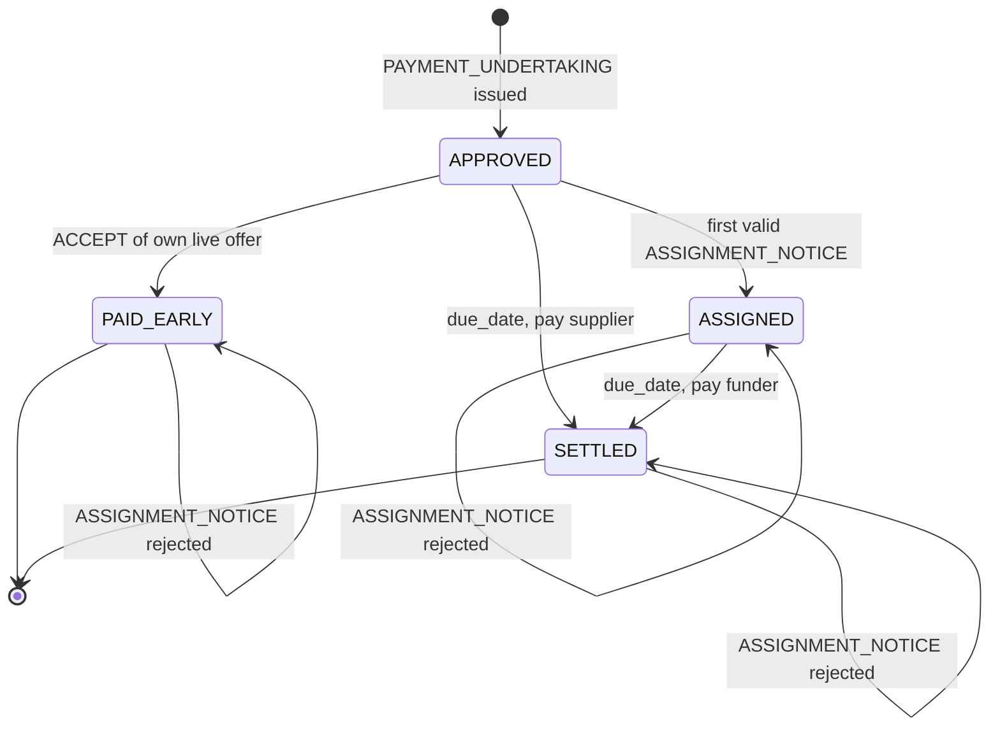

# OpenFloat Protocol — `openfloat/0.1` (draft)

OpenFloat lets a supplier holding a **buyer-approved invoice** get paid early, with the gap between the
supplier's preferred pay date and the buyer's due date filled by the cheapest available liquidity source:
the buyer's own cash or a funder. It is a protocol, not a platform: there is no central
operator, and every participant runs (or delegates) its own node.

This document is licensed CC BY 4.0. The reference implementation is Apache-2.0.

## 1. Design principles

1. **The obligor is the source of truth.** The buyer owes the money, so the buyer's node is the only place
   that can say who will be paid at maturity. This mirrors receivables law: after a *notice of assignment*,
   the debtor must pay the assignee.
2. **Everything is signed.** Every message is an Ed25519-signed envelope. Claims that depend on another
   party's word carry that party's signed message as an embedded proof.
3. **Nodes never move money.** A node emits *settlement instructions* to rails the participant already
   uses (bank payment files and APIs). Regulated activity stays with banks and funders.
4. **Deterministic core, optional intelligence.** Validation, pricing, limits and allocation are
   deterministic. Language models may help read documents and explain outcomes; they never sign,
   validate or decide.

## 2. Roles

| Role | Holds | Responsibilities |
|---|---|---|
| **Buyer** (obligor) | Payables ledger, cash forecast | Approves invoices, signs payment undertakings, optionally pays early from own cash, acknowledges **at most one** assignment per invoice, pays the current payee at maturity |
| **Supplier** (creditor) | Receivables | Issues invoices, requests early payment, accepts at most one offer (honest behaviour) |
| **Funder** | Credit limits per buyer | Prices firm offers off the buyer's undertaking, funds only after the buyer's acknowledgement |

## 3. Identity and envelopes

A participant directory maps `node_id → (public key, role)`. In production this is a registry
comparable to Peppol's SML/SMP or a PKI; the protocol only requires key resolution.

```json
{
  "protocol": "openfloat/0.1",
  "msg_id": "9f2c…",
  "sender": "acme-buyer",
  "recipients": ["sup-07"],
  "sent_on": "2026-11-02",
  "body": { "type": "PAYMENT_UNDERTAKING", "...": "..." },
  "signature": "base64(Ed25519(canonical_json(envelope without signature)))"
}
```

Canonical JSON: sorted keys, no insignificant whitespace, UTF-8. Amounts are integers in minor units.
A receiver MUST reject an envelope whose signature, or any embedded envelope's signature, fails to
verify against the directory.

## 4. Messages

| Type | From → To | Body (key fields) | Embedded proof |
|---|---|---|---|
| `INVOICE` | Supplier → Buyer | invoice_id, supplier_id, buyer_id, amount, currency, issue_date, due_date, po_number | — |
| `PAYMENT_UNDERTAKING` | Buyer → Supplier | invoice_id, **invoice_hash**, amount, currency, due_date | — |
| `INVOICE_REJECTED` | Buyer → Supplier | invoice_id, reason | — |
| `EARLY_PAY_REQUEST` | Supplier → Buyer + Funders | invoice_id, requested_date | buyer's `PAYMENT_UNDERTAKING` |
| `OFFER` | Buyer / Funder → Supplier | offer_id, kind (`BUYER_DISCOUNT`, `FUNDER`), advance, pay_date, expires, annualised_rate | — |
| `ACCEPT` | Supplier → Offeror | supplier_id, **representation** | the signed `OFFER` |
| `ASSIGNMENT_NOTICE` | Funder → Buyer | invoice_id, invoice_hash, new_payee_id | supplier's signed `ACCEPT` |
| `ASSIGNMENT_ACK` | Buyer → Funder, Supplier | invoice_id, invoice_hash, new_payee_id, amount, due_date | — |
| `ASSIGNMENT_REJECTED` | Buyer → Funder | invoice_id, new_payee_id, reason | — |
| `SETTLEMENT_INSTRUCTION` | Payer → Payee | payer, payee, amount, value_date, rail, reference | — |

`invoice_hash` is the SHA-256 of the canonical invoice body and binds every later message to one exact
invoice.

### 4.1 Supplier representation in `ACCEPT`

`ACCEPT` carries a required field `representation`, whose only valid value is
`"NOT_ASSIGNED_OR_PLEDGED"`. It is part of the body and therefore covered by the supplier's signature.
Its meaning is:

> The supplier represents and warrants that, at the time of acceptance, the receivable identified by
> `invoice_hash` has not been assigned, sold, pledged or otherwise encumbered in favour of any party other
> than the offeror, and that it will not do so while the offer is accepted.

A funder MUST ignore an `ACCEPT` without this representation (the reference funder declines it and
records the reason). The protocol cannot see financing arranged outside it, such as a traditional factor
or a lender holding a charge over the supplier's receivables. The representation does not prevent that,
but every acceptance becomes signed evidence of it, giving the funder recourse against a supplier who
lied. A supplier that finances the same invoice with several funders leaves a signed misrepresentation
with each of them.

## 5. Flows

### 5.1 Approval
`INVOICE` → buyer validates (onboarded supplier, approval limits, no duplicate id) → `PAYMENT_UNDERTAKING`
or `INVOICE_REJECTED`. The undertaking is the buyer's irrevocable promise to pay `amount` on `due_date`,
and is what lets funders price off the **buyer's** credit rather than the supplier's.

### 5.2 Early payment
1. Supplier broadcasts `EARLY_PAY_REQUEST` with the undertaking attached.
2. Funders verify the undertaking (signed by the named buyer, buyer has role `buyer`, supplier matches
   sender) and reply with **firm** `OFFER`s. A firm offer reserves the funder's limit until `expires`.
3. The buyer batches requests and decides which to fund from its own cash (§6), replying with
   `BUYER_DISCOUNT` offers.
4. Supplier accepts one offer with `ACCEPT`.

### 5.3 Buyer-funded
On `ACCEPT` of its own live offer, for an invoice still `APPROVED`, the buyer marks it `PAID_EARLY`
and emits a `SETTLEMENT_INSTRUCTION` for the advance. Any later assignment is rejected.

### 5.4 Funder-funded
1. Funder receives `ACCEPT`. It ignores (declines) an `ACCEPT` without the `NOT_ASSIGNED_OR_PLEDGED`
   representation (§4.1), and declines early if the acknowledgment transparency log (§7) already holds an
   entry for the `invoice_hash`. Otherwise it books the exposure and sends `ASSIGNMENT_NOTICE` (embedding
   the supplier's signed `ACCEPT`, which itself embeds the funder's signed `OFFER`).
2. Buyer verifies: acceptance signed by the invoice's supplier; offer signed by the notifying funder;
   hashes match; invoice is `APPROVED`. Then sets payee := funder, status `ASSIGNED`, and replies
   `ASSIGNMENT_ACK`. **Otherwise `ASSIGNMENT_REJECTED`.**
3. On a valid `ASSIGNMENT_ACK`, the funder **publishes** its entry to the acknowledgment transparency log,
   **then checks** the log for an earlier entry (lower `seq`) for the same `invoice_hash` from a different
   funder (§7).
4. Funder funds **only after** a matching `ASSIGNMENT_ACK` and a clean log check. On rejection, or if the
   log shows an earlier acknowledgment to another funder, it does not fund and releases the exposure.

### 5.5 Maturity
On `due_date` the buyer pays the current payee the full face value. Funder exposure is released.

### Invoice state machine (buyer node)



`PAID_EARLY` is closed: the supplier has already been paid, so nothing is due at maturity. In any state
other than `APPROVED`, a further `ASSIGNMENT_NOTICE` is answered with `ASSIGNMENT_REJECTED`.

## 6. Buyer liquidity decision (reference behaviour)

Paying invoice *i* early moves its outflow from `due_i` to `pay_i`: the balance falls by `advance_i` on
days `[pay_i, due_i)` and rises by the discount from `due_i`. The reference node solves

```
maximise   Σ x_i · (discount_i − advance_i · cash_yield · days_i / 365)
subject to baseline_t + Σ x_i · Δ_i(t) ≥ min(floor, baseline_t)   for every day t
           x_i ∈ {0, 1}
```

where `baseline_t` is the projected balance including known payables, outstanding offers and a payables
forecast for invoices not yet received. Solved as a MILP (HiGHS); a deterministic greedy fallback is used
if the solver fails. This is node policy, not protocol: any buyer may use its own method.

## 7. Acknowledgment transparency log

The buyer's node is the source of truth for who it will pay, but a dishonest buyer could acknowledge the
same invoice to two funders. Each funder sees only its own `ASSIGNMENT_ACK`. The acknowledgment
transparency log gives funders a shared, append-only view of acknowledgments, in the style of Certificate
Transparency, so that this equivocation is detected before money moves.

### 7.1 Entry format

The log is an append-only, hash-chained list of entries:

| Field | Meaning |
|---|---|
| `seq` | Position in the log, strictly increasing |
| `invoice_hash` | The invoice the acknowledgment refers to |
| `buyer_id` | The acknowledging buyer |
| `funder_id` | The funder publishing the entry (the acknowledged payee) |
| `ack_digest` | SHA-256 of the signed `ASSIGNMENT_ACK` envelope the funder holds |
| `published_on` | Publication date |
| `prev_hash` | `entry_hash` of the previous entry (64 zeros for the first entry) |
| `entry_hash` | SHA-256 of the canonical entry, including `prev_hash` |
| `funder_signature` | The funder's Ed25519 signature over the entry |

Entries contain no amounts, prices or supplier identity beyond what `invoice_hash` commits to. Because
`invoice_hash` is a hash, it reveals nothing about the invoice by itself.

### 7.2 Funder rule

On receiving a valid `ASSIGNMENT_ACK`, the funder:

1. publishes its entry to the log; then
2. looks for an **earlier** entry (lower `seq`) with the same `invoice_hash` from a **different** funder.

If such an entry exists, the buyer has acknowledged the invoice twice. The funder MUST NOT fund, releases
its limit and raises an alarm. Otherwise it funds. The first funder is protected by its own
acknowledgment: the buyer owes it at maturity. Publishing before checking ensures that, of two funders
racing on the same invoice, the later one always sees the earlier entry.

A funder also checks the log when it receives an `ACCEPT`, and declines early if an entry for that
`invoice_hash` already exists.

### 7.3 Verification

Anyone can verify the log: recompute each `entry_hash` from the canonical entry, check that each
`prev_hash` equals the previous entry's `entry_hash` and that `seq` increases, and verify each
`funder_signature` against the directory. Altering, inserting, removing or reordering an entry breaks the
chain and is detected.

### 7.4 Trust and limitations

The log operator cannot forge entries, because each is signed by a funder, and cannot rewrite history
undetectably, because of the hash chain. It could, however, withhold or delay entries, hiding an earlier
acknowledgment from a later funder. Production mitigations, as in Certificate Transparency: several
independent logs and mirrors, signed tree heads exchanged by gossip so that participants detect a log
showing them different views, and funders publishing to more than one log. The reference implementation
runs a single in-process log.

## 8. Security properties

| Threat | Mitigation |
|---|---|
| Invoice financed twice | Buyer acknowledges one assignment per invoice; funders fund only after acknowledgement |
| Forged buyer approval | Undertaking must be signed by the buyer key in the directory |
| Funder hijacks another's deal | Notice must embed the supplier's acceptance of *that funder's* signed offer |
| Replay | Second notice for an assigned invoice is rejected; offers expire |
| Tampering in transit | Signatures over canonical JSON, recursively over embedded proofs |
| Invoice substitution | `invoice_hash` binds undertaking, offers and notices to one invoice |
| Supplier finances the invoice outside the protocol | Signed representation in `ACCEPT` (§4.1) gives recourse; funders can also check public charge registers |
| Buyer acknowledges two funders | Acknowledgment transparency log (§7): the later funder sees the earlier entry and does not fund |
| Log tampering or reordering | Hash chain and funder signatures; mirrors and signed tree heads against withholding |

## 9. Design rationale and open questions

**Why no shared ledger?** For each component, ask: *is there a party everyone would trust to run this?*
For approved payables the answer is yes, the obligor. Only the buyer can say who it will pay at maturity,
so the buyer's node is the registry. A shared ledger earns its place only for assets with no natural
authority, such as transferable documents where possession confers title. Those may be added later behind
the same request layer.

**Why the buyer's approval is enough evidence.** In open-account trade the buyer approves an invoice after
receiving the goods. The undertaking *is* the attestation that the trade happened, so no external oracle
is needed.

**What if the buyer acknowledges two funders?** The legal remedy still applies: each `ASSIGNMENT_ACK` is
a signed undertaking to pay that funder, so a buyer that acknowledges twice owes twice, and the residual
risk is buyer insolvency, which funders already price. In addition, the acknowledgment transparency log
(§7) makes the equivocation detectable before funding: the later funder finds the earlier acknowledgment
in the log and does not pay out, so only one funder is exposed. The log is a shared view of
acknowledgments only, not a ledger of the invoices themselves, and the buyer remains the source of truth.

**What if the supplier finances the invoice outside the protocol?** The protocol cannot see a traditional
factoring agreement or a charge held by the supplier's lender. The signed representation in `ACCEPT`
(§4.1) turns each acceptance into evidence of a warranty that the receivable is unencumbered, so a
supplier who double-finances outside the protocol is exposed to claims from the funder it misled.

**Open questions**

1. **Governance.** Who owns the specification and the participant directory? Consortium-owned trade
   networks failed when owners withdrew funding. The intended model is a neutral foundation (FINOS-style),
   with change control and conformance testing, and no single commercial owner.
2. **Identity.** The directory must bind node keys to verified legal entities. GLEIF vLEI (verifiable
   Legal Entity Identifiers) is the leading candidate.
3. **Incentives and sustainability.** Buyers adopt for discount income, supplier resilience and no platform
   fee. Funders adopt for buyer-quality assets with built-in double-financing protection. Maintenance can be
   funded by hosted nodes, compliance tooling and certification, without a fee on every transaction.
4. **Dilution.** Credit notes and disputes can reduce the amount owed after approval. Funders need a defined
   rule for how dilution affects assigned invoices.

## 10. Out of scope for 0.1

- Mechanisms that compel payment (direct-debit mandates, a bank acting as paying agent, programmable money
  or atomic settlement) are deliberately excluded. They depend on jurisdiction and licensing, so they are
  left to bilateral arrangements between participants and their banks. The protocol coordinates and
  evidences obligations; banks move money; the law enforces the obligations.
- Transport and discovery (reference implementation uses an in-process bus; HTTPS + directory lookup next).
- Key rotation and revocation; directory governance.
- Multiple independent acknowledgment logs, signed tree heads and gossip (the reference implementation
  runs one in-process log).
- Dilution: credit notes and disputes after approval.
- Partial financing and term extension (with accounting guardrails under ASU 2022-04 / IAS 7 disclosures).
- Card payments are deliberately not a funder route: a card issuer lends to the buyer, and a card payment
  extinguishes the invoice rather than assigning it. A future version may model card as a buyer-side
  payment option.
- Mapping `INVOICE` to Peppol BIS Billing 3.0 / InvoiceNow documents.
