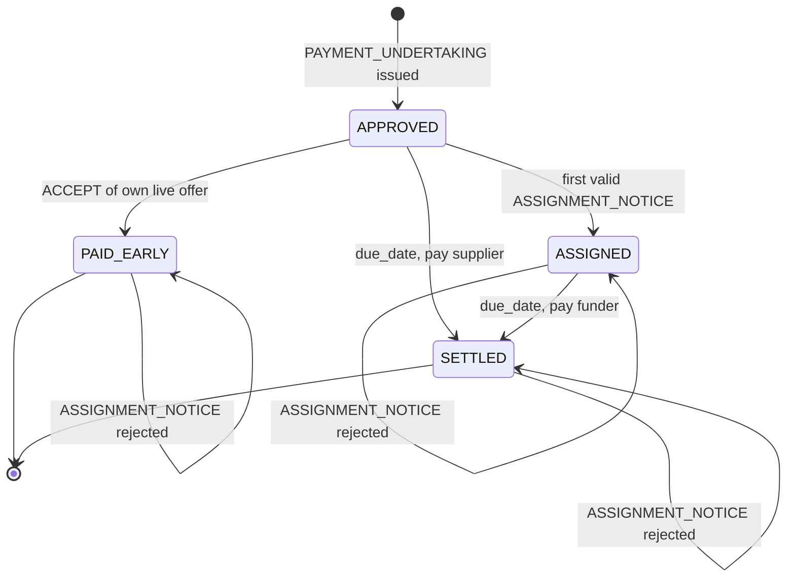

# OpenFloat Protocol — `openfloat/0.1` (draft)

OpenFloat lets a supplier holding a **buyer-approved invoice** get paid early, with the gap between the
supplier's preferred pay date and the buyer's due date filled by the cheapest available liquidity source:
the buyer's own cash, a funder, or a card issuer. It is a protocol, not a platform: there is no central
operator, and every participant runs (or delegates) its own node.

This document is licensed CC BY 4.0. The reference implementation is Apache-2.0.

## 1. Design principles

1. **The obligor is the source of truth.** The buyer owes the money, so the buyer's node is the only place
   that can say who will be paid at maturity. This mirrors receivables law: after a *notice of assignment*,
   the debtor must pay the assignee.
2. **Everything is signed.** Every message is an Ed25519-signed envelope. Claims that depend on another
   party's word carry that party's signed message as an embedded proof.
3. **Nodes never move money.** A node emits *settlement instructions* to rails the participant already
   uses (bank payment files/APIs, card issuing APIs). Regulated activity stays with banks, funders and
   card issuers.
4. **Deterministic core, optional intelligence.** Validation, pricing, limits and allocation are
   deterministic. Language models may help read documents and explain outcomes; they never sign,
   validate or decide.

## 2. Roles

| Role | Holds | Responsibilities |
|---|---|---|
| **Buyer** (obligor) | Payables ledger, cash forecast | Approves invoices, signs payment undertakings, optionally pays early from own cash, acknowledges **at most one** assignment per invoice, pays the current payee at maturity |
| **Supplier** (creditor) | Receivables | Issues invoices, requests early payment, accepts at most one offer (honest behaviour) |
| **Funder** | Credit limits per buyer | Prices firm offers off the buyer's undertaking, funds only after the buyer's acknowledgement |
| **Card issuer** | Card programme limits | A funder whose offer settles over card rails (T+1, flat fee) |

## 3. Identity and envelopes

A participant directory maps `node_id → (public key, role)`. In production this is a registry
comparable to Peppol's SML/SMP or a PKI; the protocol only requires key resolution.

```json
{
  "protocol": "openfloat/0.1",
  "msg_id": "9f2c…",
  "sender": "acme-buyer",
  "recipients": ["sup-07"],
  "sent_on": "2026-11-02",
  "body": { "type": "PAYMENT_UNDERTAKING", "...": "..." },
  "signature": "base64(Ed25519(canonical_json(envelope without signature)))"
}
```

Canonical JSON: sorted keys, no insignificant whitespace, UTF-8. Amounts are integers in minor units.
A receiver MUST reject an envelope whose signature, or any embedded envelope's signature, fails to
verify against the directory.

## 4. Messages

| Type | From → To | Body (key fields) | Embedded proof |
|---|---|---|---|
| `INVOICE` | Supplier → Buyer | invoice_id, supplier_id, buyer_id, amount, currency, issue_date, due_date, po_number | — |
| `PAYMENT_UNDERTAKING` | Buyer → Supplier | invoice_id, **invoice_hash**, amount, currency, due_date | — |
| `INVOICE_REJECTED` | Buyer → Supplier | invoice_id, reason | — |
| `EARLY_PAY_REQUEST` | Supplier → Buyer + Funders | invoice_id, requested_date, accepts_card | buyer's `PAYMENT_UNDERTAKING` |
| `OFFER` | Buyer / Funder → Supplier | offer_id, kind (`BUYER_DISCOUNT`, `FUNDER`, `CARD`), advance, pay_date, expires, annualised_rate | — |
| `ACCEPT` | Supplier → Offeror | supplier_id | the signed `OFFER` |
| `ASSIGNMENT_NOTICE` | Funder → Buyer | invoice_id, invoice_hash, new_payee_id | supplier's signed `ACCEPT` |
| `ASSIGNMENT_ACK` | Buyer → Funder, Supplier | invoice_id, invoice_hash, new_payee_id, amount, due_date | — |
| `ASSIGNMENT_REJECTED` | Buyer → Funder | invoice_id, new_payee_id, reason | — |
| `SETTLEMENT_INSTRUCTION` | Payer → Payee | payer, payee, amount, value_date, rail, reference | — |

`invoice_hash` is the SHA-256 of the canonical invoice body and binds every later message to one exact
invoice.

## 5. Flows

### 5.1 Approval
`INVOICE` → buyer validates (onboarded supplier, approval limits, no duplicate id) → `PAYMENT_UNDERTAKING`
or `INVOICE_REJECTED`. The undertaking is the buyer's irrevocable promise to pay `amount` on `due_date`,
and is what lets funders price off the **buyer's** credit rather than the supplier's.

### 5.2 Early payment
1. Supplier broadcasts `EARLY_PAY_REQUEST` with the undertaking attached.
2. Funders verify the undertaking (signed by the named buyer, buyer has role `buyer`, supplier matches
   sender) and reply with **firm** `OFFER`s. A firm offer reserves the funder's limit until `expires`.
3. The buyer batches requests and decides which to fund from its own cash (§6), replying with
   `BUYER_DISCOUNT` offers.
4. Supplier accepts one offer with `ACCEPT`.

### 5.3 Buyer-funded
On `ACCEPT` of its own live offer, for an invoice still `APPROVED`, the buyer marks it `PAID_EARLY`
and emits a `SETTLEMENT_INSTRUCTION` for the advance. Any later assignment is rejected.

### 5.4 Funder-funded
1. Funder receives `ACCEPT`, books the exposure, sends `ASSIGNMENT_NOTICE` (embedding the supplier's signed
   `ACCEPT`, which itself embeds the funder's signed `OFFER`).
2. Buyer verifies: acceptance signed by the invoice's supplier; offer signed by the notifying funder;
   hashes match; invoice is `APPROVED`. Then sets payee := funder, status `ASSIGNED`, and replies
   `ASSIGNMENT_ACK`. **Otherwise `ASSIGNMENT_REJECTED`.**
3. Funder funds **only after** a matching `ASSIGNMENT_ACK`; on rejection it releases the exposure.

### 5.5 Maturity
On `due_date` the buyer pays the current payee the full face value. Funder exposure is released.

### Invoice state machine (buyer node)



`PAID_EARLY` is closed: the supplier has already been paid, so nothing is due at maturity. In any state
other than `APPROVED`, a further `ASSIGNMENT_NOTICE` is answered with `ASSIGNMENT_REJECTED`.

## 6. Buyer liquidity decision (reference behaviour)

Paying invoice *i* early moves its outflow from `due_i` to `pay_i`: the balance falls by `advance_i` on
days `[pay_i, due_i)` and rises by the discount from `due_i`. The reference node solves

```
maximise   Σ x_i · (discount_i − advance_i · cash_yield · days_i / 365)
subject to baseline_t + Σ x_i · Δ_i(t) ≥ min(floor, baseline_t)   for every day t
           x_i ∈ {0, 1}
```

where `baseline_t` is the projected balance including known payables, outstanding offers and a payables
forecast for invoices not yet received. Solved as a MILP (HiGHS); a deterministic greedy fallback is used
if the solver fails. This is node policy, not protocol: any buyer may use its own method.

## 7. Security properties

| Threat | Mitigation |
|---|---|
| Invoice financed twice | Buyer acknowledges one assignment per invoice; funders fund only after acknowledgement |
| Forged buyer approval | Undertaking must be signed by the buyer key in the directory |
| Funder hijacks another's deal | Notice must embed the supplier's acceptance of *that funder's* signed offer |
| Replay | Second notice for an assigned invoice is rejected; offers expire |
| Tampering in transit | Signatures over canonical JSON, recursively over embedded proofs |
| Invoice substitution | `invoice_hash` binds undertaking, offers and notices to one invoice |

## 8. Design rationale and open questions

**Why no shared ledger?** For each component, ask: *is there a party everyone would trust to run this?*
For approved payables the answer is yes, the obligor. Only the buyer can say who it will pay at maturity,
so the buyer's node is the registry. A shared ledger earns its place only for assets with no natural
authority, such as transferable documents where possession confers title. Those may be added later behind
the same request layer.

**Why the buyer's approval is enough evidence.** In open-account trade the buyer approves an invoice after
receiving the goods. The undertaking *is* the attestation that the trade happened, so no external oracle
is needed.

**What if the buyer acknowledges two funders?** Funders cannot detect this without a shared view. The
protection is legal, not technical: each `ASSIGNMENT_ACK` is a signed undertaking to pay that funder, so a
buyer that acknowledges twice owes twice. The residual risk is buyer insolvency, which is the credit risk
funders already price. Optional mitigation: funders publish hashes of acknowledgments they hold, so
duplicates become detectable.

**Open questions**

1. **Governance.** Who owns the specification and the participant directory? Consortium-owned trade
   networks failed when owners withdrew funding. The intended model is a neutral foundation (FINOS-style),
   with change control and conformance testing, and no single commercial owner.
2. **Identity.** The directory must bind node keys to verified legal entities. GLEIF vLEI (verifiable
   Legal Entity Identifiers) is the leading candidate.
3. **Incentives and sustainability.** Buyers adopt for discount income, supplier resilience and no platform
   fee. Funders adopt for buyer-quality assets with built-in double-financing protection. Maintenance can be
   funded by hosted nodes, compliance tooling and certification, without a fee on every transaction.
4. **Dilution.** Credit notes and disputes can reduce the amount owed after approval. Funders need a defined
   rule for how dilution affects assigned invoices.

## 9. Out of scope for 0.1

- Transport and discovery (reference implementation uses an in-process bus; HTTPS + directory lookup next).
- Key rotation and revocation; directory governance.
- Dilution: credit notes and disputes after approval.
- Partial financing and term extension (with accounting guardrails under ASU 2022-04 / IAS 7 disclosures).
- Card flows modelled as assignment for simplicity; real card settlement extinguishes the invoice differently.
- Mapping `INVOICE` to Peppol BIS Billing 3.0 / InvoiceNow documents.
